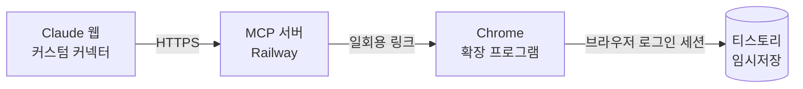

<div align="center">

# 📝 Tistory MCP

**Claude 웹 채팅 내용을 티스토리 블로그 임시저장 글로 바로 보내는 MCP 서버**

[](https://github.com/euiseok00/mcp-tistory/actions/workflows/ci.yml)


</div>

## ✨ 소개

Claude와 공부하거나 문제를 해결한 대화를 블로그에 옮기려면 복사, 붙여넣기, 서식 정리를 직접 해야 합니다.
이 서버를 Claude 웹에 **커스텀 커넥터**로 연결하면 채팅에서 한 마디로 끝납니다.

> 💬 "이 대화를 티스토리에 임시저장해줘"

1. Claude가 대화를 정해진 템플릿에 맞춰 제목과 마크다운 본문으로 정리합니다.
2. 서버가 목차·서식을 붙여 티스토리 HTML로 바꾸고 **일회용 링크**를 돌려줍니다.
3. 링크에서 미리보기를 확인하고 **임시저장** 버튼을 누르면 Chrome 확장 프로그램이 저장합니다.
4. 티스토리 임시저장함에서 검토한 뒤 직접 발행합니다.

**이런 분께 맞습니다:** 티스토리 블로그를 운영하고, Claude Pro 이상을 쓰며, PC Chrome을 쓰는 분.

## 📄 결과물

기본 템플릿으로 저장되는 글은 이런 모양입니다.

| 요소 | 모양 |
|---|---|
| ✨ 도입 | 글 첫머리 1~2문장을 한 단계 큰 글씨로 (박스 없음) |
| 📑 목차 | 도입 뒤에 펼친 상태로 자동 생성. 클릭하면 해당 제목으로 이동. 굵은 "목차" 제목과 밑줄, 대주제는 파란 두 자리 번호(01)와 굵은 글씨, 소주제는 회색으로 들여쓰기 |
| 🧩 제목 | `1. 대주제` / `1.1 소주제` 두 단계, 이모지 없음 (서버가 지움) |
| 📊 본문 | 짧은 문단 + 표 · 목록 · 코드블록 위주, SVG 다이어그램 이미지 최대 5개(적극 사용) |
| 💡 강조 박스 | 💡 참고 · 📌 핵심 · ⚠️ 주의 · ✅ 결론 등 인용 박스. 대주제마다 최소 1개, 필요한 곳에만 |
| 🎨 색상 | 대화에서 중요하다고 한 부분은 파란색, 주의할 부분은 빨간색 |

## 🏗️ 동작 구조



- **Claude → 서버:** 인증 없이 연결합니다. 서버는 대화 전체가 아니라 Claude가 보낸 글만 받습니다.
- **확장 프로그램 → 티스토리:** 티스토리 Open API가 종료되어, 에디터가 쓰는 내부 API를 브라우저 로그인 세션으로 호출합니다. 쿠키를 읽거나 서버로 보내지 않습니다.
- **서버:** Railway(미국 US West)에서 돕니다. 글은 메모리에만 최대 30분 머뭅니다. 자세한 내용은 서버의 `/privacy`(개인정보처리방침)에 있습니다.

## 🚀 사용 시작

### 1. 준비물

| 항목 | 비고 |
|---|---|
| Claude Pro 이상 | 커스텀 커넥터 기능 필요 |
| PC Chrome | 확장 프로그램 설치 |
| 티스토리 블로그 | 글쓰기 권한이 있는 계정, 브라우저에 로그인 |

### 2. 확장 프로그램 설치

웹 스토어 등록 전이라 지금은 직접 설치합니다.

1. 저장소를 받고 `.env`에 서버 주소를 넣습니다.

   ```bash
   git clone https://github.com/euiseok00/mcp-tistory.git
   cd mcp-tistory
   cp .env.example .env   # PUBLIC_URL=https://<서비스>.up.railway.app
   npm run ext:config     # extension/manifest.json 생성
   ```

2. `chrome://extensions`에서 개발자 모드를 켜고, **압축해제된 확장 프로그램 로드**로 `extension` 폴더를 선택합니다.

### 3. Claude 웹에 연결

1. Claude 웹 → **설정 → 커넥터 → 커스텀 커넥터 추가**
2. URL에 `https://<서비스>.up.railway.app/mcp` 입력. 인증 설정은 비워 둡니다.
3. 새 채팅에서 *"이 대화를 티스토리에 임시저장해줘"* → 받은 링크를 열어 **임시저장** 클릭

## ✍️ 사용법

### 요청 예시

| 하고 싶은 것 | 이렇게 말하기 |
|---|---|
| 대화 전체 정리 | "이 대화를 티스토리에 임시저장해줘" |
| 일부만 정리 | "제네릭 얘기부터 끝까지만 정리해서 임시저장해줘" |
| 색상 강조 | "A는 중요, B는 주의로 표시해줘" |
| 구조 지정 | "문제 → 원인 → 해결 순서로 정리해줘" |
| 다른 글 구조 따라하기 | "https://….tistory.com/10 글 구조를 참고해줘" (공개 글만) |

### 템플릿 바꾸기

요청에서 구조를 지정하면 기본 템플릿보다 우선합니다.

| 범위 | 방법 |
|---|---|
| 이번 글만 | 요청할 때 원하는 구조를 함께 말하기 |
| 항상 | Claude 웹의 프로젝트 지침이나 개인 설정에 구조를 적어 두기 |
| 기본값 변경 | `src/tool.ts`의 `기본 템플릿:` 부분을 고치고 배포 → 커넥터 **다시 연결** |

목차 생성, 이모지 확대, 구분선(`---`) 제거, 색상 제한(파랑 `#006dd7`, 빨강 `#ee2323`만)은 템플릿과 상관없이 서버가 항상 적용합니다.

## 🛠️ 문제 해결

| 증상 | 원인과 해결 |
|---|---|
| 커넥터 추가 시 404 / 연결 실패 | URL 끝에 `/mcp`가 있는지 확인하세요. 서버가 재배포 중이었다면 커넥터를 삭제하고 다시 추가하세요. |
| 403 응답 | 서버의 `PUBLIC_URL`이 실제 접속 주소와 다릅니다. |
| 429 응답 | 요청 제한에 걸렸습니다. 1분 뒤 다시 요청하세요. |
| 링크에 로그인 안내가 표시됨 | 티스토리에 다시 로그인하고 링크 페이지를 새로고침하세요. |
| 링크에 설치 안내가 표시됨 | 확장 프로그램이 없거나 서버 주소가 바뀌었습니다. `npm run ext:config` 후 확장 프로그램을 새로고침하세요. |
| 링크 만료 | 링크는 30분간 유효하고, 저장 후나 서버 재배포 후에는 쓸 수 없습니다. Claude에 다시 요청하세요. |
| 저장 실패 안내가 반복됨 | 티스토리가 요청을 거부했거나 내부 API가 바뀌었을 수 있습니다. |
| `INVALID_INPUT` | 제목(50자) 또는 본문(50,000자) 길이를 넘었습니다. 구간을 나눠 요청하세요. |

## 🔐 보안

- 🌐 `/mcp`는 인증 없이 공개되어 있습니다. 누구나 링크를 만들 수 있지만, 저장은 내 브라우저에서 미리보기를 보고 버튼을 눌러야만 이뤄집니다.
- 🚦 글 생성 요청은 분당 횟수로 제한됩니다. Claude를 거친 요청은 전체 사용자가 한도를 함께 씁니다.
- 🧹 본문의 `<script>`, 이벤트 속성, `javascript:` 링크 등 위험한 HTML은 저장 전에 제거됩니다. 미리보기에서는 외부 링크가 동작하지 않습니다.
- 🔗 링크를 아는 사람은 30분 동안 글을 볼 수 있습니다.
- 📵 로그에는 제목·본문 길이와 결과 코드만 남고, 본문·토큰은 남지 않습니다.

## ⚠️ 한계

- **비공식 API:** 티스토리 Open API가 종료되어 에디터 내부 API를 씁니다. 예고 없이 동작하지 않을 수 있고, 약관상 회색지대입니다. 본인 책임으로 사용하세요.
- **클릭 필요:** 저장하려면 링크를 열고 버튼을 눌러야 합니다. PC Chrome만 지원합니다.
- **이미지:** SVG 다이어그램(최대 5개)만 자동으로 첨부됩니다. 일반 이미지는 지원하지 않습니다.
- **긴 대화:** 대화 앞부분이 압축되면 Claude가 지정 구간을 정확히 못 볼 수 있습니다.

## 🧑‍💻 개발

```bash
npm install
npm run dev     # .env를 읽어 로컬 실행 (http://localhost:3000)
npm test        # 단위 테스트
npx tsc --noEmit
```

로컬 확인은 MCP Inspector(`npx @modelcontextprotocol/inspector`)로 할 수 있습니다.

배포는 Railway가 GitHub 저장소의 `Dockerfile`로 합니다. `main`에 push하면 다시 배포됩니다. Railway Variables에는 `PUBLIC_URL`(Railway 도메인)과 `PORT=3000`을 넣고, 인스턴스는 1개로 두고 슬립을 끕니다. 작업을 메모리에 두기 때문입니다.

| 파일 | 역할 |
|---|---|
| `src/index.ts` | Express 앱, `/mcp` 엔드포인트, `/privacy` |
| `src/tool.ts` | `tistory_write_post` 도구와 기본 템플릿 |
| `src/markdown.ts` | 마크다운 → 티스토리 HTML (목차, 이모지, 색상 제한, 다이어그램, 위험 HTML 제거) |
| `src/jobs.ts` | 일회용 링크 작업 저장소, 미리보기 페이지, 확장 프로그램용 API, 요청 제한 |
| `src/privacy.ts` | 개인정보처리방침 |
| `extension/` | 다이어그램 업로드, 티스토리 임시저장 호출과 응답 분류 (Chrome MV3) |
| `Dockerfile` | Railway 배포 이미지 |

## 🗺️ 로드맵

- [x] 임시저장, 기본 템플릿
- [x] 태그, SVG 다이어그램
- [x] Railway 배포, 공개 전환
- [ ] Chrome 웹 스토어 등록
- [ ] 카테고리
- [ ] 일반 이미지
- [ ] 발행 · 수정 · 삭제

---

<div align="center">
<sub>학습 목적의 개인 프로젝트입니다. Tistory·Kakao와 관련이 없습니다.</sub>
</div>
