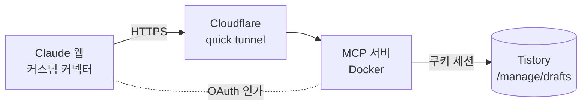

<div align="center">

# 📝 Tistory MCP

**Claude 웹 채팅에서 한 마디로, 대화 내용을 티스토리 임시저장 글로.**

[](https://github.com/euiseok00/mcp-tistory/actions/workflows/ci.yml)


</div>

---

## ✨ 무엇을 하나요?

> "지금까지 대화를 티스토리에 정리해줘"

Claude가 대화를 제목과 마크다운 본문으로 정리해 `tistory_write_post` 도구를 호출하면,
이 서버가 티스토리 HTML로 변환해 **임시저장**합니다. 발행은 하지 않으므로 검토 후 직접 발행하면 됩니다.

| | |
|---|---|
| 🧰 **도구** | `tistory_write_post` 1개 |
| ✍️ **지원 문법** | 제목 · 목록 · 표 · 코드블록(언어 지정) · 인용 · 링크 · 굵게/기울임 |
| 🛡️ **보안** | OAuth 2.1 (PKCE, DCR) · 위험 HTML 제거 · 쿠키/본문 로그 미기록 |
| 📦 **실행** | Docker + Cloudflare quick tunnel, 명령 1줄 |

## 🏗️ 아키텍처



- **전송:** Streamable HTTP, stateless + JSON 응답 모드 (quick tunnel은 SSE 미지원)
- **인증 (Claude → 서버):** 서버 내장 OAuth 인가 서버. 소유자 패스프레이즈 1개로 승인
- **인증 (서버 → 티스토리):** 브라우저 로그인 쿠키. 파일로 주입, 재시작 없이 교체 가능

## 🚀 빠른 시작

### 1. 준비물
- Docker
- Claude Pro 이상 (커스텀 커넥터)
- 티스토리 블로그 로그인 쿠키

### 2. 설정

```bash
cp .env.example .env
mkdir secrets
```

`.env`
```ini
OWNER_PASSPHRASE=16자-이상의-긴-패스프레이즈
TISTORY_BLOG_NAME=myblog          # https://myblog.tistory.com
TISTORY_COOKIE_FILE=./secrets/tistory_cookie.txt
```

`secrets/tistory_cookie.txt`
브라우저 DevTools → Network → `{blog}.tistory.com/manage` 요청의 `cookie` 헤더 값 전체를 붙여넣습니다.

### 3. 실행

```bash
npm run up      # 터널 → URL 확인 → 서버 시작, 마지막에 커넥터 URL 출력
npm run down    # 종료
```

### 4. Claude 웹 연결
1. 설정 → 커넥터 → **커스텀 커넥터 추가** → 출력된 `https://….trycloudflare.com/mcp` 입력
2. 인가 화면에서 `OWNER_PASSPHRASE` 입력 → **허용**
3. 채팅에서 *"이 대화를 티스토리에 임시저장해줘"*

> [!IMPORTANT]
> quick tunnel URL은 실행할 때마다 바뀝니다. 재실행 시 커넥터를 다시 등록하세요.

## 🔧 도구 명세

**`tistory_write_post`**

| 입력 | 타입 | 제한 |
|---|---|---|
| `title` | string | 한 줄, 1~50자 |
| `content_markdown` | string | 1~50,000자 |

```jsonc
// 성공
{ "ok": true, "draftId": 13, "title": "제목" }
// 실패
{ "ok": false, "errorCode": "SESSION_EXPIRED", "message": "..." }
```

| errorCode | 의미 | 대응 |
|---|---|---|
| `INVALID_INPUT` | 입력 길이·형식 오류 | 입력 수정 |
| `SESSION_EXPIRED` | 티스토리 쿠키 만료 | `secrets/tistory_cookie.txt` 교체 |
| `TISTORY_REJECTED` | 티스토리가 요청 거부 | 내부 API 변경 여부 확인 |
| `UNKNOWN` | 네트워크·기타 오류 | 로그 확인 |

## 📁 프로젝트 구조

```
src/
├── index.ts       # Express 앱, OAuth 라우터, /mcp 엔드포인트
├── auth.ts        # 내장 OAuth 인가 서버 (메모리 저장)
├── tool.ts        # tistory_write_post 도구, 입력 검증
├── markdown.ts    # 마크다운 → HTML, sanitize
├── tistory.ts     # TistoryClient 인터페이스 + 쿠키 구현체
└── core.test.ts   # 단위 테스트
scripts/up.mjs     # 터널 URL을 받아 서버를 띄우는 실행 스크립트
userMD/            # 요구사항, 티스토리 내부 API 조사 기록
```

## 🧑‍💻 개발

```bash
npm install
npm run dev     # .env 읽어서 로컬 실행 (http://localhost:3000)
npm test        # 단위 테스트
npm run build   # dist/ 로 컴파일
```

MCP Inspector로 로컬 확인: `npx @modelcontextprotocol/inspector`

## 🔐 보안 메모

- 🔑 `.env`, `secrets/`는 git과 Docker 이미지에 포함되지 않습니다.
- 🌐 quick tunnel은 **공개 주소**입니다. 쓸 때만 켜고 끝나면 `npm run down`.
- 🚫 패스프레이즈 5회 실패 시 15분 잠금. access token 1시간, refresh token 회전.
- 📵 로그에는 제목·본문 길이와 결과 코드만 남깁니다.

## ⚠️ 알려진 한계

- 티스토리 Open API는 종료되어 **비공식 내부 API**를 사용합니다. 예고 없이 깨질 수 있고 약관상 회색지대입니다.
- 쿠키는 수동 갱신이 필요합니다 (카카오 2차 인증 때문에 자동 로그인 미지원).
- 서버 재시작 시 OAuth 토큰이 초기화되어 재인가가 필요합니다.
- 긴 대화는 앞부분이 압축되어 Claude가 지정 구간을 정확히 못 볼 수 있습니다.

## 🗺️ 로드맵

- [x] 임시저장 (MVP)
- [x] OAuth 2.1 인가
- [x] Docker + quick tunnel 실행
- [x] CI (타입체크 + 테스트)
- [ ] 태그 · 카테고리
- [ ] 이미지
- [ ] 발행 · 수정 · 삭제

---

<div align="center">
<sub>학습 목적의 개인 프로젝트입니다. Tistory·Kakao와 무관합니다.</sub>
</div>
