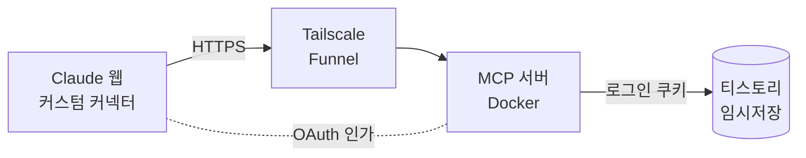

<div align="center">

# 📝 Tistory MCP

**Claude 웹 채팅 내용을 티스토리 블로그 임시저장 글로 바로 보내는 MCP 서버**

[](https://github.com/euiseok00/mcp-tistory/actions/workflows/ci.yml)


</div>

## ✨ 소개

Claude와 공부하거나 문제를 해결한 대화를 블로그에 옮기려면 복사, 붙여넣기, 서식 정리를 직접 해야 합니다.
이 서버를 Claude 웹에 **커스텀 커넥터**로 연결하면 채팅에서 한 마디로 끝납니다.

> 💬 "이 대화를 티스토리에 임시저장해줘"

1. Claude가 대화를 정해진 템플릿에 맞춰 제목과 마크다운 본문으로 정리합니다.
2. 서버가 목차·서식을 붙여 티스토리 HTML로 바꾸고 **임시저장**합니다.
3. 티스토리 임시저장함에서 검토한 뒤 직접 발행합니다. 서버는 발행하지 않습니다.

**이런 분께 맞습니다:** 티스토리 블로그를 운영하고, Claude Pro 이상을 쓰며, Docker를 실행할 수 있는 분.

## 📄 결과물

기본 템플릿으로 저장되는 글은 이런 모양입니다.

| 요소 | 모양 |
|---|---|
| 📑 목차 | 글 맨 앞에 자동 생성. 클릭하면 해당 제목으로 이동. 대주제는 크게, 소주제는 작게 들여쓰기 |
| 🧩 제목 | `1. 🧩 대주제` / `1.1 소주제` 두 단계, 대주제마다 이모지 |
| 📊 본문 | 짧은 문단 + 표 · 목록 · 코드블록 위주 |
| 💡 강조 박스 | 💡 참고 · 📌 핵심 · ⚠️ 주의 · ✅ 결론 등 인용 박스 |
| 🎨 색상 | 대화에서 중요하다고 한 부분은 파란색, 주의할 부분은 빨간색 |

## 🏗️ 동작 구조



- **Claude → 서버:** 서버에 OAuth 인가 서버가 들어 있습니다. 처음 연결할 때 내가 정한 패스프레이즈를 입력해 승인합니다.
- **서버 → 티스토리:** 티스토리 Open API가 종료되어, 브라우저 로그인 쿠키로 에디터가 쓰는 내부 API를 호출합니다.
- **외부 공개:** Tailscale Funnel이 내 PC의 서버를 고정 HTTPS 주소(`https://tistory-mcp.<tailnet>.ts.net`)로 공개합니다. 무료이고 도메인이 필요 없습니다.

## 🚀 설치와 실행

### 1. 준비물

| 항목 | 비고 |
|---|---|
| Docker (Docker Desktop 포함) | |
| [Tailscale](https://tailscale.com) 계정 | 무료 |
| Claude Pro 이상 | 커스텀 커넥터 기능 필요 |
| 티스토리 블로그 | 글쓰기 권한이 있는 계정 |

### 2. 저장소 받기

```bash
git clone https://github.com/euiseok00/mcp-tistory.git
cd mcp-tistory
cp .env.example .env
mkdir secrets
```

### 3. Tailscale 준비 (최초 1회)

1. [관리 콘솔](https://login.tailscale.com/admin) → **DNS**에서 **MagicDNS**와 **HTTPS Certificates**를 켭니다.
2. **Access controls**에서 Funnel을 허용합니다. 정책의 `nodeAttrs`에 `"attr": ["funnel"]`을 추가합니다(콘솔이 안내 버튼을 띄워 주기도 합니다).
3. **Settings → Keys → Generate auth key**로 인증 키를 만듭니다.
4. **DNS** 화면에서 tailnet 이름을 확인합니다. 예: `tail1234.ts.net` → 서버 주소는 `https://tistory-mcp.tail1234.ts.net`

### 4. 티스토리 쿠키 넣기

1. 브라우저로 티스토리에 로그인하고 `https://{블로그명}.tistory.com/manage`에 들어갑니다.
2. 개발자 도구(F12) → **Network** 탭 → 새로고침 → `manage` 요청을 클릭합니다.
3. **Request Headers**의 `cookie` 값 전체를 복사해 `secrets/tistory_cookie.txt`에 붙여넣습니다.

> [!WARNING]
> 이 쿠키는 내 티스토리 계정 로그인 그 자체입니다. 다른 사람과 공유하거나 커밋하지 마세요. `secrets/`는 `.gitignore`와 `.dockerignore`에 들어 있습니다.

### 5. `.env` 작성

```ini
OWNER_PASSPHRASE=16자-이상의-긴-패스프레이즈    # 커넥터 연결 승인용
TISTORY_BLOG_NAME=myblog                      # https://myblog.tistory.com 이면 myblog
TISTORY_COOKIE_FILE=./secrets/tistory_cookie.txt
PUBLIC_URL=https://tistory-mcp.tail1234.ts.net # 3단계에서 확인한 주소
TS_AUTHKEY=tskey-auth-...                      # 첫 실행 후에는 지워도 됨
```

### 6. 실행

```bash
npm run up      # docker compose up -d --build
npm run down    # 종료
```

처음 실행하면 Tailscale 인증서 발급에 1분 정도 걸릴 수 있습니다. 아래 주소가 JSON을 돌려주면 준비된 것입니다.

```
https://tistory-mcp.<tailnet>.ts.net/.well-known/oauth-authorization-server
```

### 7. Claude 웹에 연결

1. Claude 웹 → **설정 → 커넥터 → 커스텀 커넥터 추가**
2. URL에 `https://tistory-mcp.<tailnet>.ts.net/mcp` 입력 → **연결**
3. 뜨는 인가 화면에서 `OWNER_PASSPHRASE`를 입력하고 **허용**
4. 새 채팅에서 *"이 대화를 티스토리에 임시저장해줘"*

> [!NOTE]
> 주소가 고정이라 커넥터 등록과 인가는 한 번이면 됩니다. 인가 정보는 `mcp-state` 볼륨에 저장되어 코드를 고치고 `npm run up`으로 다시 빌드해도 유지됩니다. `docker compose down -v`로 볼륨을 지우면 다시 연결해야 합니다.

## ✍️ 사용법

### 요청 예시

| 하고 싶은 것 | 이렇게 말하기 |
|---|---|
| 대화 전체 정리 | "이 대화를 티스토리에 임시저장해줘" |
| 일부만 정리 | "제네릭 얘기부터 끝까지만 정리해서 임시저장해줘" |
| 색상 강조 | "A는 중요, B는 주의로 표시해줘" |
| 구조 지정 | "문제 → 원인 → 해결 순서로 정리해줘" |
| 다른 글 구조 따라하기 | "https://….tistory.com/10 글 구조를 참고해줘" (공개 글만) |

### 템플릿 바꾸기

요청에서 구조를 지정하면 기본 템플릿보다 우선합니다.

| 범위 | 방법 |
|---|---|
| 이번 글만 | 요청할 때 원하는 구조를 함께 말하기 |
| 항상 | Claude 웹의 프로젝트 지침이나 개인 설정에 구조를 적어 두기 |
| 기본값 변경 | `src/tool.ts`의 `기본 템플릿:` 부분을 고치고 `npm run up` → 커넥터 **다시 연결** |

목차 생성, 이모지 확대, 구분선(`---`) 제거, 색상 제한(파랑 `#006dd7`, 빨강 `#ee2323`만)은 템플릿과 상관없이 서버가 항상 적용합니다.

## 🛠️ 문제 해결

| 증상 | 원인과 해결 |
|---|---|
| 커넥터 추가 시 404 / 연결 실패 | 서버가 재시작 중이었거나 아직 준비 전입니다. 위 `.well-known` 주소가 열리는지 확인한 뒤 커넥터를 삭제하고 다시 추가하세요. |
| 403 응답 | `.env`의 `PUBLIC_URL`이 실제 Tailscale 주소와 다릅니다. 고친 뒤 `npm run up`. |
| `SESSION_EXPIRED` | 티스토리 쿠키가 만료되었습니다. 4단계대로 쿠키 파일만 교체하면 됩니다(재시작 불필요). |
| `TISTORY_REJECTED` / `UNKNOWN` | 티스토리가 요청을 거부했거나 내부 API가 바뀌었을 수 있습니다. `docker compose logs mcp`로 결과 코드를 확인하세요. |
| `INVALID_INPUT` | 제목(50자) 또는 본문(50,000자) 길이를 넘었습니다. 구간을 나눠 요청하세요. |
| 인증서 오류(`not able to issue TLS certs`) | Tailscale DNS 설정에서 HTTPS Certificates가 꺼져 있습니다. |

## 🔐 보안

- 🌐 Funnel 주소는 **인터넷에 공개**됩니다. 쓸 때만 켜고 끝나면 `npm run down` 하세요.
- 🔑 커넥터 연결은 `OWNER_PASSPHRASE`를 아는 사람만 승인할 수 있습니다. 5회 틀리면 15분 잠깁니다.
- 🎟️ access token 1시간, refresh token은 사용할 때마다 교체됩니다.
- 🧹 본문의 `<script>`, 이벤트 속성, `javascript:` 링크 등 위험한 HTML은 저장 전에 제거됩니다.
- 📵 로그에는 제목·본문 길이와 결과 코드만 남고, 본문·쿠키·토큰은 남지 않습니다.

## ⚠️ 한계

- **비공식 API:** 티스토리 Open API가 종료되어 에디터 내부 API를 씁니다. 예고 없이 동작하지 않을 수 있고, 약관상 회색지대입니다. 본인 책임으로 사용하세요.
- **쿠키 수동 갱신:** 카카오 2차 인증 때문에 자동 로그인은 지원하지 않습니다.
- **이미지 미지원:** 글에는 텍스트·표·코드만 들어갑니다.
- **긴 대화:** 대화 앞부분이 압축되면 Claude가 지정 구간을 정확히 못 볼 수 있습니다.

## 🧑‍💻 개발

```bash
npm install
npm run dev     # .env를 읽어 로컬 실행 (http://localhost:3000)
npm test        # 단위 테스트
npx tsc --noEmit
```

로컬 확인은 MCP Inspector(`npx @modelcontextprotocol/inspector`)로 할 수 있습니다.

| 파일 | 역할 |
|---|---|
| `src/index.ts` | Express 앱, OAuth 라우터, `/mcp` 엔드포인트 |
| `src/auth.ts` | 내장 OAuth 인가 서버 (패스프레이즈 승인) |
| `src/tool.ts` | `tistory_write_post` 도구와 기본 템플릿 |
| `src/markdown.ts` | 마크다운 → 티스토리 HTML (목차, 이모지, 색상 제한, 위험 HTML 제거) |
| `src/tistory.ts` | 티스토리 임시저장 API 호출과 응답 분류 |
| `docker-compose.yml`, `tailscale/serve.json` | 서버 + Tailscale Funnel |

## 🗺️ 로드맵

- [x] 임시저장, OAuth 인가, 기본 템플릿
- [x] Docker + Tailscale Funnel (고정 URL)
- [ ] 태그 · 카테고리
- [ ] 이미지
- [ ] 발행 · 수정 · 삭제

---

<div align="center">
<sub>학습 목적의 개인 프로젝트입니다. Tistory·Kakao와 관련이 없습니다.</sub>
</div>
