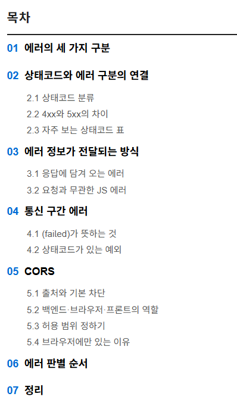
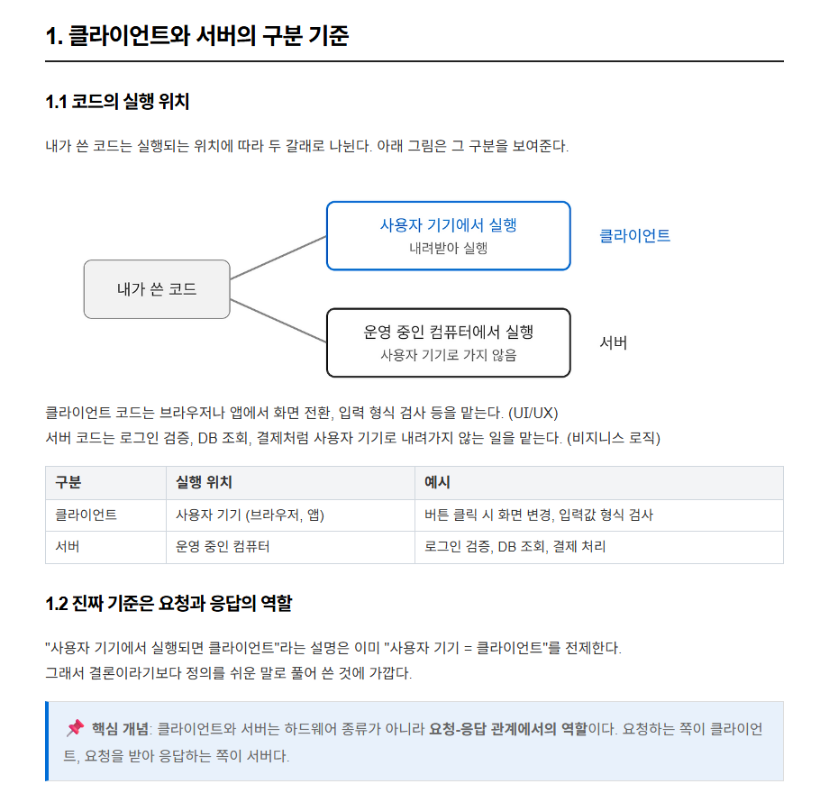
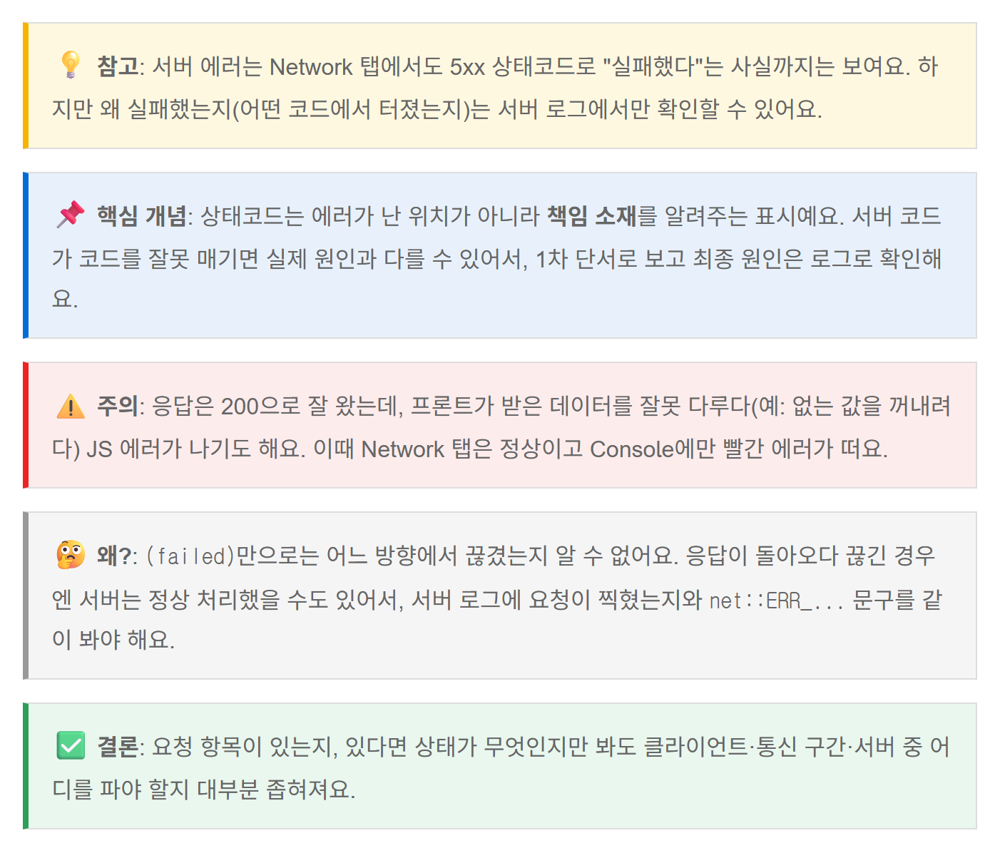
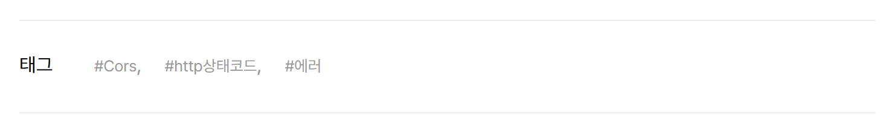

# 📝 Tistory MCP

**Claude 웹 채팅 내용을 티스토리 블로그 임시저장 글로 바로 보내는 도구**

## ✨ 무엇을 하나요

Claude 웹 채팅에서 한 마디로 대화를 블로그 글로 정리해 티스토리 **임시저장**함에 넣습니다.
웹에서 공부한 내용을 매번 같은 깔끔한 서식(목차, 강조 박스, 다이어그램, 태그)으로 블로그에 쌓을 수 있습니다.

> 💬 "이 대화를 티스토리에 임시저장해줘"

## 🖼️ 저장 예시

실제로 이 도구로 저장한 글: [에러 분류와 확인 위치, 상태코드·CORS 개념 정리](https://jounges00.tistory.com/24)

<table>
<tr><td align="center">
<b>목차</b> · 대주제·소주제 제목으로 자동 생성  

</td></tr>
<tr><td align="center">
<b>다이어그램</b> · Claude가 그린 SVG를 이미지로 자동 첨부 (최대 5개)  

</td></tr>
<tr><td align="center">
<b>강조 박스</b> · 참고 · 핵심 개념 · 주의 · 왜? · 결론  

</td></tr>
<tr><td align="center">
<b>태그</b> · 글 내용에 맞춰 자동으로 붙음  

</td></tr>
</table>

## 🚀 시작하기

### 준비물

- Claude 계정
- PC Chrome
- 티스토리 블로그, Chrome에서 로그인된 상태

### 1. Chrome 확장 프로그램 설치

[Chrome 웹 스토어](https://chromewebstore.google.com/detail/mcp-tistory/hbaiomakbjdigmdbljjjoieoblddbohb)에서 **Chrome에 추가**를 누릅니다.

### 2. Claude 웹에 연결

1. Claude 웹 → **설정 → 커넥터 → 커스텀 커넥터 추가**
2. URL에 `https://mcp-tistory-production.up.railway.app/mcp` 입력. 인증 설정은 비워 둡니다.

## ✍️ 사용법

| 하고 싶은 것 | 이렇게 말하기 |
|---|---|
| 대화 전체 정리 | "이 대화를 티스토리에 임시저장해줘" |
| 일부만 정리 | "제네릭 얘기부터 끝까지만 정리해서 임시저장해줘" |
| 색상 강조 | "A는 중요, B는 주의로 표시해줘" |
| 구조 지정 | "문제 → 원인 → 해결 순서로 정리해줘" |
| 다른 글 구조 따라하기 | "https://….tistory.com/10 글 구조를 참고해줘" (공개 글만) |

항상 같은 구조를 원하면 Claude 웹의 프로젝트 지침이나 개인 설정에 적어 두세요.

> [!NOTE]
> 미리보기는 실제 티스토리 블로그와 일부 다르게 보일 수 있습니다. 임시저장한 뒤 티스토리에서 확인하세요.

## 🛠️ 문제 해결

| 증상 | 해결 |
|---|---|
| 링크에 설치 안내가 표시됨 | 확장 프로그램이 없거나 꺼져 있습니다. 설치 후 링크 페이지를 새로고침하세요. |
| 링크에 로그인 안내가 표시됨 | Chrome에서 티스토리에 다시 로그인하고 링크 페이지를 새로고침하세요. |
| 링크 만료 | 링크는 30분간 유효하고 한 번 저장하면 끝납니다. Claude에 다시 요청하세요. |
| "요청이 너무 많습니다" | 이용자 전체가 분당 횟수를 나눠 씁니다. 1분 뒤 다시 요청하세요. |
| `INVALID_INPUT` | 제목(50자) 또는 본문(50,000자)이 너무 깁니다. 구간을 나눠 요청하세요. |
| 저장 실패가 반복됨 | 티스토리 쪽 변경일 수 있습니다. [이슈](https://github.com/euiseok00/mcp-tistory/issues)로 알려 주세요. |

## ⚠️ 알아 둘 점

티스토리 비공식 기능을 쓰는 개인 프로젝트라 예고 없이 동작하지 않을 수 있습니다. 
[개인정보처리방침] : https://mcp-tistory-production.up.railway.app/privacy
